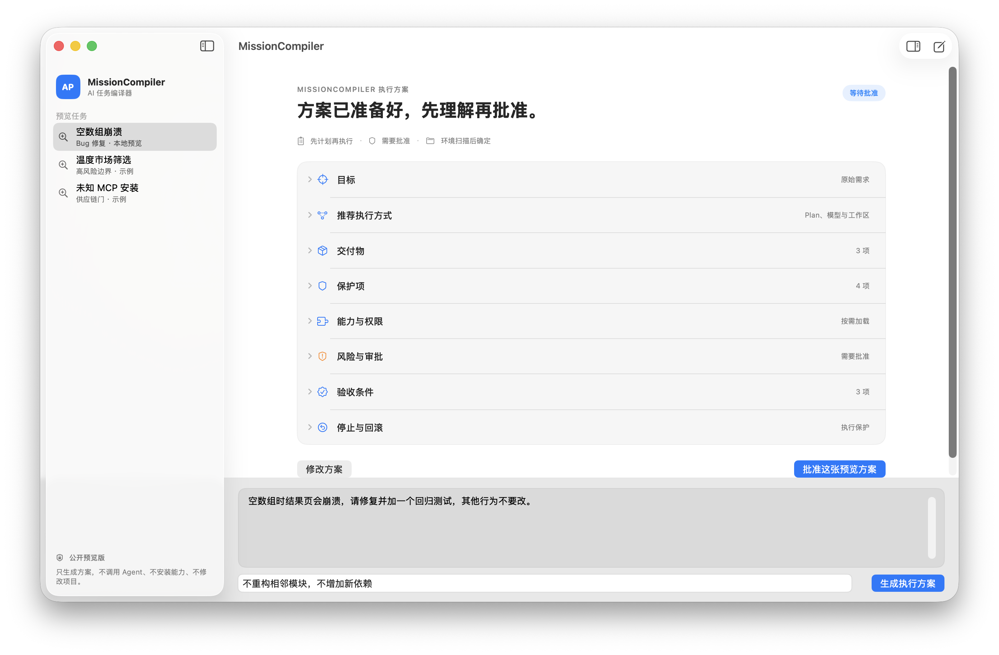
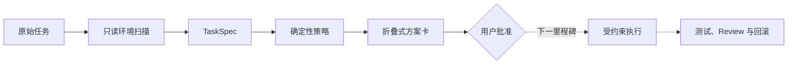

# MissionCompiler

> 把一句原始任务，编译成安全、可审批、可验收的 Agent 执行合同。


普通用户不应该先学会 Plan、模型层级、reasoning effort、Skills、插件、MCP 和权限策略，才能把一件事交给 AI。MissionCompiler 的目标是让用户只说清楚目标和不可触碰的边界，系统负责检查环境、推荐执行方式、解释风险，并用真实证据验收结果。



**[直接打开折叠式网页样机](https://djhyes.github.io/missioncompiler/designs/missioncompiler-macos/)** · 无需安装，不会执行真实任务

## 当前能做什么

这是一个诚实标注边界的公开预览，不是已经完成的 Agent 执行器。

| 能力 | 状态 |
| --- | --- |
| 确定性风险、审批、模型层级和工作区策略 | 可用，30 个评测任务通过 |
| 原生 macOS 方案界面 | 可用，可检测本机 Codex CLI |
| 折叠式执行方案 | 可用，默认只显示项目，点击后展开细节 |
| Codex 可发现的项目级 Skill | POC 可用 |
| Codex App Server 动态扫描 | 下一里程碑 |
| 驱动 Codex 修改真实项目 | 尚未启用 |
| 自动安装 Skill、插件或 MCP | 尚未启用 |

当前版本不会调用 Agent 执行任务，不会修改项目，不会安装能力，也不会发送消息、部署、付款或创建真实订单。

## 快速体验

要求：macOS 14 或更高版本、Swift 6 工具链。运行 Python 策略测试需要 Python 3.9 或更高版本。

```bash
git clone https://github.com/djhyes/missioncompiler.git
cd missioncompiler
./script/build_and_run.sh
```

脚本会构建一个项目本地的 `dist/MissionCompiler.app` 并以前台 macOS App 启动。也可以使用 Codex App 中自动出现的 Run 操作。

运行全部验证：

```bash
swift test
PYTHONPATH=src python3 -m unittest discover -s tests -v
PYTHONPATH=src python3 -m missioncompiler.cli eval evals/tasks.json
```

试用确定性策略引擎：

```bash
PYTHONPATH=src python3 -m missioncompiler.cli decide evals/sample-facts.json
```

查看网页交互样机：

```bash
python3 -m http.server 4311
```

然后打开 `http://localhost:4311/designs/missioncompiler-macos/index.html`。

## 为什么不是“提示词优化器”

MissionCompiler 把一句自然语言任务转换成 TaskSpec，再由可版本化的规则决定执行方式和边界：



模型负责把语言和已观察环境整理成事实；确定性策略负责不可绕过的风险、审批和停止条件。模型信心不能覆盖用户禁止项、权限边界或供应链信任门。

## 设计原则

- **先事实，后建议：** 能从仓库、配置和工具状态确认的事情不问用户。
- **先合同，后执行：** 修改前先展示目标、影响、权限、风险、验收和回滚。
- **默认简洁：** 只显示方案项目，点击才展开细节；技术字段默认隐藏。
- **最小能力：** 没有任务需要就不连接、不加载、不安装。
- **红色动作逐次批准：** 发布、发送、付款、真实订单和生产写入不能被一次总批准覆盖。
- **完成必须有证据：** 测试、构建、视觉检查和 Review 优先于 Agent 自述。

## 仓库结构

```text
.
├── Sources/                         # 原生 macOS App 与 Swift 核心
├── Tests/                           # Swift 回归测试
├── src/missioncompiler/             # Python 确定性策略引擎
├── tests/                           # Python 回归测试
├── evals/                           # 30 个基准任务
├── schemas/                         # TaskSpec JSON Schema
├── .agents/skills/missioncompiler/  # 项目级 Codex Skill POC
├── designs/missioncompiler-macos/   # 网页交互样机
└── docs/                            # PRD、架构、规则和路线图
```

更完整的边界与路线见 [架构](docs/ARCHITECTURE.md)、[产品规格](docs/PRD_V0.1.md)、[决策规则](docs/DECISION_RULES.md) 和 [路线图](docs/ROADMAP.md)。

`docs/ci.yml.example` 保存了待启用的 GitHub Actions 定义；当前发布仍以本地可复现验证结果为准。

## 参与和许可

欢迎先通过 Issue 提交真实任务样本、失败案例和体验反馈。当前仓库尚未选择开源许可证，因此公开可见不等于已授予复制、修改或分发权；在许可证确定前，请先不要提交代码 PR。详情见 [贡献说明](CONTRIBUTING.md) 和 [许可证状态](LICENSE_STATUS.md)。

## 独立项目声明

MissionCompiler 是独立社区项目，与 OpenAI 无隶属或背书关系。Codex、OpenAI 及相关名称属于其各自权利人。
